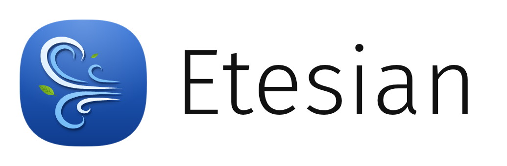

  <picture>
    <source media="(prefers-color-scheme: dark)" srcset="etesian-lockup-dark.png">
    
  </picture>

<b>The Nokia N9, re-envisioned for every screen.</b>

  <a href="https://etesian-design.com">etesian-design.com</a> · <a href="https://etesian-design.com/desktop">Try it in your browser</a>

---

Calm, content-first and built around gestures: the ideas that made the N9 special, taken further and brought to the
desktop, to phones and to the web, from one design language.

| Project | What it is |
|---|---|
| [**Etesian for KDE Plasma**](https://github.com/Etesian-design/plasma) | The look and behaviour on the Linux desktop: menu bar, dock, the window carousel, Events and snapping. |
| [**Etesian for LineageOS**](https://github.com/Etesian-design/android_vendor_etesian) | The home views, edge swipes, lock screen, status menu and apps, for any phone running LineageOS. |
| [**Etesian Design**](https://github.com/Etesian-design/design) | The design language: the guide, Vue 3 components and design tokens everything else is built from. |
| [**Website**](https://github.com/Etesian-design/website) | etesian-design.com: a working Etesian desktop and phone in the browser. |

Everything is in development, and there are no downloads yet.

Etesian is an independent project, not affiliated with Nokia, and ships no Nokia files.
